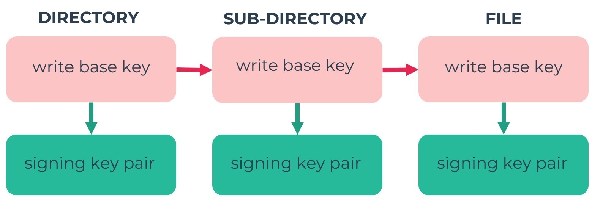

# Access control

Read access to your files is controlled by a data structure called cryptree, which is essentially a tree of symmetric keys, where the holder of one key can decrypt all the descendant keys. The result is extremely fine grained access control. You can grant access to someone to a file and that user won't be able to see any of the sibling files in the same folder (or even their names - or even their labels in the champ). Granting read access to a folder implies granting read access to all the contents of the folder recursively.

## Full and restricted keys

Every file and folder has a base key, B, which is its full read key. From it anyone can derive a restricted key, R, using HKDF-SHA256. The derivation only goes one way: there is no way to get B back from R.

The restricted key opens everything needed to read an item and everything below it. For a file that is its name, size, modification time, mime type and thumbnail, and its data key, which decrypts the contents. For a folder it is the list of its children, with each child's restricted key, and its properties key P′, which decrypts its name.

The base key opens all of that, and the way back up as well. Each file and folder has a parent link, which points at the folder it is in. A file's parent link is encrypted with its base key. A folder's base key holds its parent key P, which decrypts the folder's own parent link, and which its children's parent links point to. P′ is derived from P, so a holder of P can read the folder's name, but a holder of P′ can't get P. So holding the base key to an item lets you walk up the tree and learn the names of the folders above it (though nothing else in them), whereas holding the restricted key only lets you go down.

A folder's entry for each child holds the child's restricted key, and the child's base key encrypted with the folder's base key. So the base key to a folder gives the base keys to everything inside it, and the restricted key gives only restricted keys.

When you share a file or folder with a friend they get its base key, so they can see where it is in your drive. A [secret link](/features/secret.html) can instead give out restricted keys, so whoever opens it sees only the items themselves, under their own names, and neither your username nor the folders they're in.

## Writing through a restricted key

A writable secret link that hides where its items are combines a restricted read key with a write key. Whoever holds it can upload files, make folders, rename, edit and delete, but there are two things they can't do the normal way, because they don't have the folder's base key.

The first is giving the folder the base key of something new. They know the base key of anything they create, but can't encrypt it with the folder's base key. Instead every folder has an X25519 key pair derived from its base key, whose public half is stored with the list of children, and they seal the new item's base key to that public key (an anonymous box, as in libsodium). Only someone with the folder's base key can open it.

The second is the new item's parent link, which needs the folder's parent key. Until it has one, the item is pending. The first time the owner shares it directly, or adds it to a link that doesn't hide where it is, their client gives it new keys and a real parent link, so its maker can't use what they knew to reach anything above it.

Moving an existing item also needs keys a restricted writer doesn't have: a new parent link, and the item's base key for its new folder. So a move through such a link is done as a copy followed by a delete, and the copy is pending like any other new item.

## Older data

Files and folders written before restricted keys existed have no restricted key, and their parent link is readable by anyone with the folder's key. They are still read and written as before. Creating a link that hides where an item is rewrites it, and everything inside it, in the new format first, and anything rewritten for another reason (an edit, for example) is written in the new format too.

The server can't tell the formats apart, nor which kind of key or link wrote a block: every node carries the same fields, of the same sizes, whether or not anyone can open them. The new format adds 84 bytes to each child entry in a folder, and about 130 bytes to each folder.

## Write access

Write access is independently controlled by a similar, but simpler cryptree. All updates to a given subtree are signed by a corresponding writing key pair. When you grant write access to a file or folder then that item is moved to a new writing key pair, to keep the fine grained access control applicable to write access too. This operates independently of the read access control cryptree, and the same write key works with either a base key or a restricted key.

